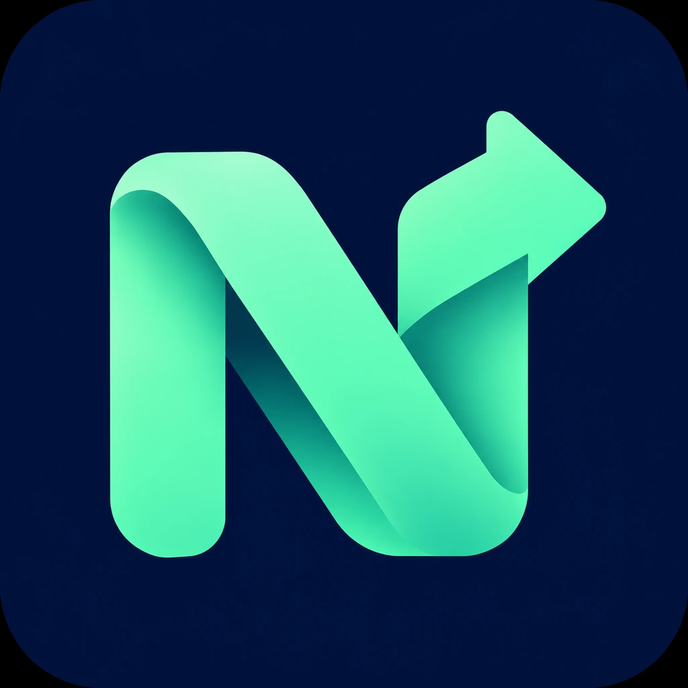

<div align="center">



# NextPrompt · 下一步

**想好下一步，不必守着等。**

为长时间 ChatGPT 对话准备的浏览器扩展：先写好下一条，等本轮完成后自动发送。

本地优先 · 中文工作台 · 无需 API Key · 无构建安装 · Chrome / Edge

[快速安装](#快速安装) · [使用方式](#使用方式) · [功能边界](#功能边界) · [技术设计](docs/ARCHITECTURE.md) · [后续路线](docs/ROADMAP.md)

</div>

---

## 为什么做这个项目

一个项目改进任务可能运行半小时。你已经想到下一步，甚至把消息和文件都准备好了，却还要反复切回页面，等到回复结束后再按发送。

NextPrompt 把这个等待环节交给浏览器。你负责决定下一步，它负责在页面满足发送条件后，把明确指定的消息发送出去。

它针对两种习惯设计：

- **已经在 ChatGPT 输入框写好下一条**：点击“本轮结束后发送当前草稿”，文件继续留在原生输入框里。
- **脑中已经排好了后续工作**：把多个文字任务放入独立队列，按顺序等待每轮回答完成后发送。

## v1.2 新界面

深蓝与薄荷绿的任务工作台，配套折带 N 箭头 logo。分为 **工作台 / 任务队列 / 设置** 三个页面，可切换网页侧栏与浮窗。

- 工作台集中展示当前对话、运行状态、待发送数量和结束约定。
- 任务队列支持搜索、排序、原位编辑；取消编辑保留原任务。
- 设置集中管理备份、诊断和运行记录；暂停按钮始终可见。
- 布局偏好本地保存，支持窄窗口与键盘操作。

[界面与操作说明](docs/INTERFACE.md) · [Logo 与生成提示词](branding/README.md)

## 当前版本实现了什么

| 功能 | v1.2 状态 | 具体行为 |
| --- | --- | --- |
| 本轮结束后发送草稿 | 已实现 | 比对草稿与附件状态，稳定结束后仅尝试发送一次 |
| 文字任务队列 | 已实现 | 添加、编辑、删除、排序，支持多轮逐条发送 |
| 附件随原生草稿发送 | 已实现，依赖页面适配 | 保留 ChatGPT 已附加的文件；不搬运、不重新上传 |
| 按对话保存 | 已实现 | 每个对话路径独立存储；刷新、切换后默认暂停 |
| 防止覆盖草稿 | 已实现 | 队列遇到原生输入框有内容或附件时等待 |
| 发送结果核验 | 已实现 | 检查新用户消息与发送文本一致；结果不明则锁定 |
| 多标签页协调 | 已实现 | 后台服务对同一对话发放短时发送租约 |
| 暂停与诊断 | 已实现 | 随时停止后续点击，复制不含正文的状态信息 |
| 任务导入、导出 | 已实现 | JSON 文件；导入后需手动启动 |
| 手机／微信小程序远程投递 | 后续计划 | 当前版本没有远程接收服务 |
| API 自动规划下一步 | 后续计划 | 当前版本不会调用模型或自动生成任务 |

**验证状态：**核心决策单元测试和脚本/清单检查已通过。仓库包含离线浏览器集成测试与 CI；本次开发环境无法成功下载测试浏览器，集成测试未在该环境执行完成。尚未在真实登录的 ChatGPT / Work 页面完成兼容性验证。当前版本应视为可供安装验证的首版，不能承诺适配所有 ChatGPT 界面。

## v1.1：先约定本轮结束口令，再自动发送

**蓝色发送箭头、复制按钮和文字静止，都不能单独触发发送。** v1.1 移除了仅凭页面外观推断完成的放行路径，改为每轮随机结束口令与页面状态共同确认。

任务开始前，在面板点击 **生成并复制本轮结束约定**，粘贴到本轮提示词末尾一并发送。没有本轮约定时，自动发送拒绝启用。文字队列发出的任务会自动附加下一轮全新的约定；原生草稿不自动改写。

口令必须出现在本轮最终助手回复的最后独占一行，且不在代码块、行内代码或引用中。仍需没有已识别的运行信号、页面在线可见、附件就绪，并经过连续稳定观察和发送前复核。**这显著收紧放行条件，但不是官方后台完成事件，也不能保证模型绝不提前输出口令。**

详见 [完整判断逻辑、操作方法与可靠性边界](docs/COMPLETION.md)。

## 快速安装

日常使用不需要 Node.js、Python 或 API Key。

1. 下载这个仓库的 ZIP（GitHub 仓库页面 **Code → Download ZIP**），解压到一个固定位置。
2. Edge 打开 `edge://extensions`；Chrome 打开 `chrome://extensions`。
3. 打开“开发人员模式”。
4. 点击“加载解压缩的扩展”，选择仓库内的 **`extension` 文件夹**，不是仓库根目录。
5. 打开或刷新 `https://chatgpt.com` 中一个已有消息的对话。
6. 点击右下角 **N → 下一步** 打开控制面板。

扩展工具栏按钮也能打开面板。默认快捷键是 **Alt + Shift + Q**，如果与系统冲突，可到浏览器扩展快捷键设置修改。

也可以运行 `npm run package` 得到 `dist/nextprompt-v1.2.0.zip`，解压后加载其中的 `nextprompt` 文件夹。

> 本项目尚未发布 Chrome / Edge 官方扩展商店。使用解压扩展时需要保留文件夹；更新代码后在扩展管理页点击重新加载，再刷新 ChatGPT 页面。

## 使用方式

### 一条带文件的下一步

先为本轮项目任务设置结束约定：

1. 在面板点击 **生成并复制本轮结束约定**。
2. 将复制内容附在本轮任务提示词末尾，一并手动发送。

GPT 开始执行后，再准备下一条草稿：

1. 在 **ChatGPT 自己的输入框**写好：“请用这份新数据验证刚才的修改，报告数值与单位是否一致。”
2. 通过 ChatGPT 原生按钮上传测试文件，等附件预览稳定。
3. 打开 NextPrompt，点击 **本轮结束后发送当前草稿**。
4. 面板等待本轮唯一结束口令。口令匹配、没有运行或上传信号、页面在线可见、发送按钮可用后，开始连续稳定确认，默认 12 秒。
5. 自动点击一次原生发送按钮，并核验新消息已经出现。
6. 本条完成后自动停止。

**启用以后又改字或改附件，会暂停。** 写完后重新启用即可。这样不会在你还在组织语言时突然发送。

### 多个文字任务

先按上节为当前任务设置结束约定。在扩展的“后续任务”中依次加入：

```text
根据刚才的检查结果，列出尚未解决的问题和对应证据。
```

```text
优先修复会影响核心流程的问题，运行相关测试并报告结果。
```

```text
检查本次改动的边界情况，整理仍需人工判断的事项。
```

点击 **启动文字队列**。队列只有在手动启动后才会运行，并在两条消息之间等待新的回答完成。每条任务内容保持整体，不会按空行擅自拆分；实际发送时会在任务末尾附加下一轮新的结束约定。

**文字队列不会自动使用原生输入框中的附件。** 若要发送附件，请暂停队列，使用“当前草稿”；文件队列、跨设备文件传输属于后续工作。

### 暂停、刷新与结果不明

- **暂停全部自动发送**：停止尚未点击的发送。已经提交的消息无法撤回，也不会停止 ChatGPT 当前执行的任务。
- **刷新／切换对话**：文字队列保留，但自动运行不恢复；草稿定时发送需要重新启用。
- **发送结果待核验**：先检查聊天记录。已经发送的队列项应在解除锁定后删除，再启动剩余任务；不要盲目重复发送。
- **本轮没有结束约定**：已经运行的旧任务不要自动猜测，手动发送下一条；为后续任务提前加入约定。
- **一直等待本轮口令**：模型可能没有遵守约定，或界面不兼容。请手动检查，不要缩短倒计时绕过判断。

### 导入与导出

“设置”页面支持导出当前对话的文字队列。导入会追加任务，不覆盖现有内容。

```json
{
  "version": 1,
  "tasks": [
    { "text": "先检查现有结果，不要重复已经完成的修改。" },
    { "text": "围绕未解决问题给出下一步，并说明验证方法。" }
  ]
}
```

限制：每个对话最多 100 条；每条最多 50000 字符；导入文件最大 1 MB。导出文件含有你的任务正文，分享前请自行检查。

## 为什么不直接每隔几秒点击发送

页面暂时没有文字，并不等于任务结束。NextPrompt 使用多个条件共同判断：

1. 仅识别唯一原生输入框与明确的所属区域；不再退回任意父元素。
2. 本轮最新用户消息必须含本地生成的随机结束约定，并在启用后保持不变。
3. 最新用户消息之后的最后助手轮次必须有最终操作按钮，且以本轮口令结束。
4. 排除可识别的代码／引用口令和非最终消息通道，运行、上传、错误或确认信号必须消失。
5. 页面在线且处于前台；连续满足默认 12 秒、至少三次采样，观察中断后重新开始。
6. 取得对话发送租约，发送前再次校验相同回复身份、正文、口令、草稿和附件。
7. 持久化发送尝试后只点击一次，收到匹配的页面消息回执才完成该项。

结束口令是与模型的约定，不是 OpenAI 官方任务生命周期事件。模型错误地提前输出口令、未知运行状态等残余风险仍需真实界面验收。详见 [结束判断说明](docs/COMPLETION.md)。

## 功能边界

- 支持桌面 Chrome / Edge 的 Chromium 扩展机制，作用范围仅 `https://chatgpt.com/*`。
- 只对已有消息、URL 含 `/c/` 的稳定对话启用。尚无对话 ID 的新聊天请先手动发送第一条。
- 不修改模型选择或思考强度，使用当前页面已选设置。
- 不绕过使用额度、确认步骤、验证码或登录限制。
- 当前严格模式要求标签页可见且在线。切到后台、电脑休眠、网络中断或标签页冻结时不发送，恢复后重新观察。可将 ChatGPT 单独放在一个保持可见的窗口中。
- 当前附件识别依赖 `data-testid`、上传进度和移除按钮等 DOM 标记。未知附件组件可能识别不全，**带文件场景请先用无敏感内容的小文件验证**。
- 多标签页租约仅协调同一浏览器配置内的扩展实例；不协调不同浏览器、设备或多账户。
- 每轮必须使用新的结束约定。模型未输出口令时不会降级为“静止一段时间就发送”。
- 只核验消息已进入页面，不把“模型最终完成任务”当作发送确认的一部分。
- 不加快 GPT 的生成速度；节省的是两轮之间等待你操作的时间。

## 隐私与权限

扩展只申请 `storage` 权限，并仅在 ChatGPT 域名注入脚本。没有分析统计、广告、外部服务器、API Key 或外部网络请求代码。

- 任务文字保存在当前浏览器配置的 `chrome.storage.local`。
- 租约使用 `chrome.storage.session`，后台服务收到的是对话路径，不是提示词正文。
- 附件不另存到扩展；由 ChatGPT 原生界面上传和发送。
- 已发送任务不保留正文历史；日志只记录时间与操作状态。
- 诊断不含提示词、文件名或对话正文。
- 扩展需要读取当前页面文本与输入框才能工作。存储没有额外加密；共享电脑请注意浏览器配置的访问权限。

详见 [隐私说明](docs/PRIVACY.md) 和 [安全问题报告](SECURITY.md)。本项目与 OpenAI 没有隶属、赞助或背书关系。

## 开发与测试

运行扩展本身零依赖；开发测试建议 Node.js 22+、Python 3.10+。

```bash
npm test                 # 核心决策测试，零外部依赖
npm run check            # JS 语法、清单、图标、权限检查
npm install              # 安装浏览器测试所需 Playwright
npx playwright install chromium
npm run test:browser      # 离线页面夹具，无真实 ChatGPT 消息
npm run package          # 生成可安装扩展 ZIP
```

浏览器集成测试在拦截的本地夹具中执行，不请求真实 ChatGPT，也不使用账户凭证。它验证 UI 控制器与适配器协作，不能替代真实页面验收。GitHub Actions 会执行测试并上传扩展 ZIP，首次运行结果以 Actions 页面为准。

```text
extension/
  manifest.json       扩展入口和最小权限
  engine.js           结束协议与连续采样判断，无 DOM 依赖
  adapter.js          ChatGPT 页面适配
  ui.js               侧栏／浮窗、导航、样式与品牌资源
  content.js          队列控制、发送与持久化
  background.js       多标签页租约、工具栏和快捷键
  icons/              扩展图标
  assets/             打包的 logo 图片
scripts/              校验与可重复打包
tests/                决策、后台租约和离线浏览器测试
docs/                 设计、验收、隐私和路线
```

## 下一步发展

目标是从“替你按下一次发送”逐步发展成“你控制目标和边界的任务工作台”。

- v1.x：真实 Work 页面验收、附件组件适配、可访问性、发送回执优化。
- v2：本地任务面板、任务与附件绑定、浏览器连接；之后考虑手机投递。
- v3：经用户开启的 API 规划器，根据目标、结果证据与验收条件生成下一步建议；先人工审核，再考虑有限轮次自动执行。

[完整路线与规划器设计](docs/ROADMAP.md) 明确区分已实现和未实现能力。

## 贡献与许可

欢迎提交可以复现的页面适配问题。报告时附不含对话正文的诊断信息、浏览器版本和操作步骤，不要附登录凭证。

项目从零实现，未复制所调研扩展的源代码。灵感来自提示词队列这一通用交互方式。使用 [MIT License](LICENSE)。
