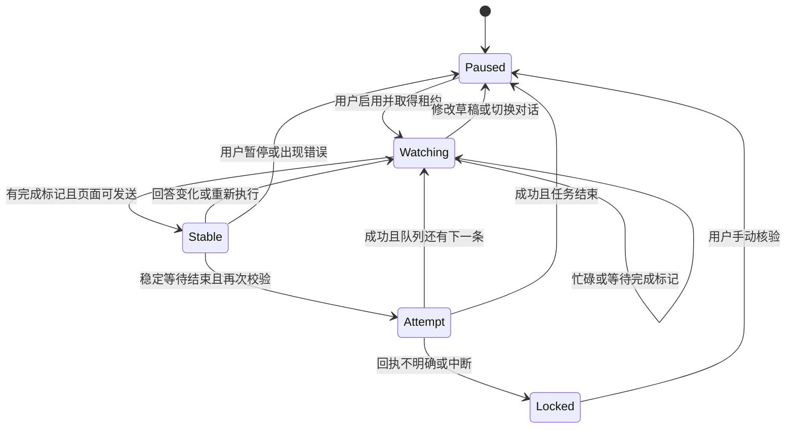

# 技术设计

## 组件职责

| 组件 | 职责 |
| --- | --- |
| 页面适配器 | 读取当前对话、草稿、附件、运行信号与完成按钮；填写和发送 |
| 决策引擎 | 纯函数式快照判断：等待、暂停或可以发送 |
| 面板控制器 | 队列编辑、任务启用、倒计时、发送日志、持久化和回执核验 |
| 后台服务 | 串行处理租约请求，协调同一浏览器配置内的标签页 |

## 状态转换



## 完成判断

不依赖固定的 30 分钟超时，不把网络静默当作结束。`Gate` 的计时从多项条件满足时开始；若最终文本、原生草稿、附件或用户消息数量变化，重新计时或暂停。轮询间隔超过 5 秒会重置稳定计时，避免休眠恢复后沿用旧倒计时。

新一条队列任务必须等到最终回答内容不同于上次发送前的回答，避免把旧完成按钮当作新一轮结束。该策略保守：完全相同的新回答会等待，需要用户处理。

页面状态没有官方事件契约。Work 新界面或工具执行面板可能使用不同标记；必须通过真实页面验收再声明兼容。维护适配时只改 `adapter.js`，并增加相应夹具。

## 发送事务

1. 取得／续期当前路径的 15 秒租约。
2. 对文字队列，在没有原生草稿和附件时填写任务文本。
3. 重新读取页面并校验任务、对话、上传、忙碌和发送按钮。
4. 持久化 `inFlight` 记录。
5. 再次校验并点击一次发送。
6. 最多观察约 5 秒，查找用户消息数量增加一条、最后消息文字一致且输入框清空。
7. 回执明确后清除 `inFlight`、移除已发送队列项；否则暂停并保留待核验标记。

这是“每次启用最多一次点击尝试＋结果不明停止”，不是网络级 exactly-once 保证。虚拟列表变化、异常渲染、多个浏览器或人工并发操作仍可能造成无法核验。

## 存储结构

键：`nextprompt:v1:<pathname>`。

```json
{
  "version": 1,
  "items": [{ "id": "uuid", "text": "用户明确指定的下一步" }],
  "cooldown": 12,
  "logs": [{ "time": "ISO timestamp", "text": "操作状态，不含正文" }],
  "inFlight": null
}
```

草稿自动发送的正文快照只存在当前内容脚本内存。刷新后不恢复运行；ChatGPT 是否恢复原生草稿由其自身决定。`inFlight` 在刷新后仍锁定自动发送，直至用户核验。

本地存储写入在单个页面内串行。跨标签页的运行使用后台租约协调，后台 Promise 链避免两个标签同时取得租约。租约存于 session 存储，服务工作线程休眠后仍可续期；浏览器重启会清除租约，但不会恢复自动运行。

## 扩展原则

- 不使用 ChatGPT 私有网络接口或导出登录凭证。
- 新能力新增权限时先说明用途。
- API Key 不应嵌入扩展包；远程投递和 API 规划器需要另行设计认证、上下文选择和预算。
