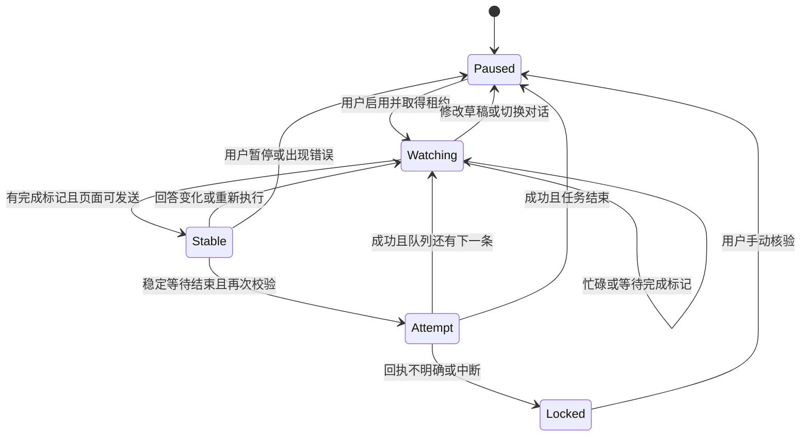

# 技术设计

## 组件职责

| 组件 | 职责 |
| --- | --- |
| 页面适配器 | 读取当前对话、草稿、附件、运行信号与完成按钮；填写和发送 |
| 决策引擎 | 纯函数式快照判断：等待、暂停或可以发送 |
| 面板控制器 | 队列编辑、任务启用、倒计时、发送日志、持久化和回执核验 |
| 后台服务 | 串行处理租约请求，协调同一浏览器配置内的标签页 |

## 状态转换



## 完成判断

v1.1 使用本地生成的每轮随机口令。只有当前用户消息含约定、最后助手轮次在非代码／引用的最终位置输出同一口令，且没有已知运行信号时，才开始稳定期。复制按钮仅作为必要的页面结构线索，不能单独放行。不存在弱条件自动降级。

`Gate.eligible` 同时供轮询判断和发送前复核使用，避免最终点击遗漏严格条件。连续观察使用 `performance.now()`；超过 5 秒的间断、页面可见性或网络变化重置稳定期，至少需要三次不同时间的采样。

每个任务绑定用户消息全文、用户消息数量、当前路径、本轮口令；稳定窗口同时绑定最终消息身份及正文。文字队列附加新的随机约定，消费旧口令，不用“文本和上一轮不同”代表任务完成。

页面字段不是官方任务事件，模型遵守约定也不是强保证。完整边界和迁移操作见 [COMPLETION.md](COMPLETION.md)。

## 发送事务

1. 取得／续期当前路径的 15 秒租约。
2. 对文字队列，在没有原生草稿和附件时填写任务文本，并明确附加下一轮随机结束约定。
3. 重新读取页面，使用同一严格校验器检查本轮口令、最终回复身份和正文、任务、对话、上传、忙碌和发送按钮。
4. 持久化 `inFlight` 记录（包含下一轮口令，便于中断后的人工核验）。
5. 再次校验并点击一次发送。
6. 最多观察约 5 秒，查找用户消息数量增加一条、最后消息文字一致且输入框清空。
7. 回执明确后清除 `inFlight`、移除已发送队列项、消费本轮口令并注册下一轮口令；否则暂停并保留待核验标记。

这是“每次启用最多一次点击尝试＋结果不明停止”，不是网络级 exactly-once 保证。虚拟列表变化、异常渲染、多个浏览器或人工并发操作仍可能造成无法核验。

## 存储结构

键：`nextprompt:v1:<pathname>`。

```json
{
  "version": 1,
  "items": [{ "id": "uuid", "text": "用户明确指定的下一步" }],
  "cooldown": 12,
  "tokens": ["NEXT_PROMPT_DONE_<32 hexadecimal characters>"],
  "logs": [{ "time": "ISO timestamp", "text": "操作状态，不含正文" }],
  "inFlight": null
}
```

草稿自动发送的正文快照只存在当前内容脚本内存。刷新后不恢复运行；ChatGPT 是否恢复原生草稿由其自身决定。`inFlight` 在刷新后仍锁定自动发送，直至用户核验。

本地存储写入在单个页面内串行。跨标签页的运行使用后台租约协调，后台 Promise 链避免两个标签同时取得租约。租约存于 session 存储，服务工作线程休眠后仍可续期；浏览器重启会清除租约，但不会恢复自动运行。

## 扩展原则

- 不使用 ChatGPT 私有网络接口或导出登录凭证。
- 新能力新增权限时先说明用途。
- API Key 不应嵌入扩展包；远程投递和 API 规划器需要另行设计认证、上下文选择和预算。
